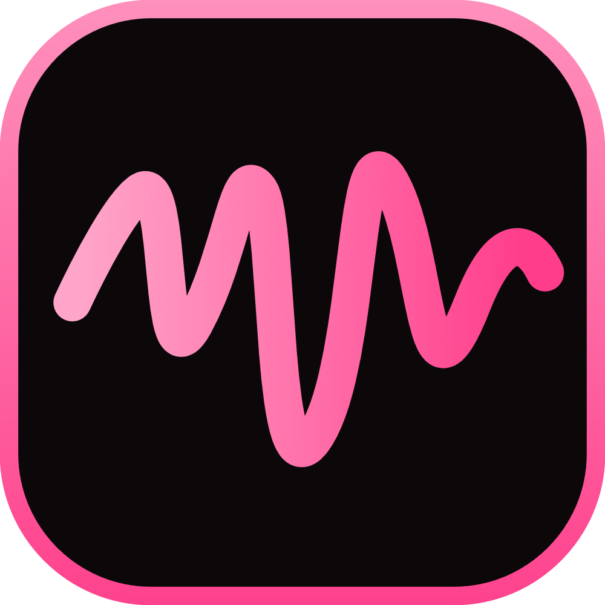

# ToyBridge-Releases

Installers and updates for ToyBridge

Drives Intiface toys (Lovense and anything else Intiface Central supports) from VRChat SPS contacts. Built to stay running: start it once and leave it in the tray.

Current version: **0.2.0**

## What it handles without restarts
- **VRChat started before or after ToyBridge, or restarted.** ToyBridge listens on UDP 9001, where VRChat always sends OSC, and also advertises itself over OSCQuery. If VRChat sends over OSCQuery, ToyBridge frees 9001 for other apps. If 9001 is taken, it retries every 10s. A watchdog checks every 5s and reopens any listening port that hit an error or was dropped.
- **Avatar changes.** Values are cleared and the new avatar's SPS parts are read from VRChat's OSCQuery server.
- **VRChat closing or crashing.** All values drop to zero, so toys stop. This is detected from the Windows process list within about 5 seconds, and also when VRChat stops answering for about 20 seconds. A freeze while a world loads isn't mistaken for a crash.
- **Other OSC apps.** Only avatar data counts as VRChat, so a stray message from another app can't make ToyBridge stop listening.
- **A toy rejecting commands.** ToyBridge waits longer between retries (up to 5 seconds) and logs the problem once, not on every try.
- **Intiface Central closed or restarted.** Reconnects every 3s, and logs the outage once rather than on every try.
- **Intiface going silent without closing, such as a network drop.** A command with no reply gives up after 5s, and three in a row reconnect.
- **A failed toy scan, such as Bluetooth being off.** Retries every 5s.
- **Toys turning off, dropping out or coming back.** It keeps scanning, so they reappear on their own. Settings are saved per toy name, so they come back too.

## Using it
1. In Intiface Central, press **Start Server**.
2. In VRChat, turn on OSC (Action Menu → Options → OSC → Enabled).
3. Each motor gets its own channel strip, like on a mixing desk:
   - **On / Off** turns that motor on or off. The big meter shows its current level, and the thin bar beside it shows the raw contact.
   - **Depth / Motion / Mix:** Depth (closer or deeper = stronger), Motion (faster movement = stronger), or Mix.
   - **Min / Max:** Min is the level as soon as anything touches.
   - **Routing** opens a panel to choose what the motor reacts to (my hands, others' hands, my own parts, others' parts, frotting), which part types, and which SPS parts. If you pick no parts, it follows all of them.
   - **Test** pulses the motor for a moment.
4. The **Master** fader on the right scales every toy. **Stop all** below it, or in the tray menu, stops every toy at once.
5. **Avatar**, **Log** and **Settings** in the top bar open in a panel on the right. Esc or **Close** hides it.
6. When a new version has downloaded, **Restart to update** appears in the top bar. ToyBridge never restarts by itself, so toys won't stop mid-session. If you don't click it, the update installs the next time you quit ToyBridge. **Settings** shows your version and has **Check now**.

Don't run OscGoesBrrr at the same time, or both apps will drive the same toys.